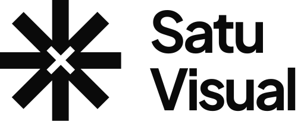

  <picture>
    <source media="(prefers-color-scheme: dark)" srcset="logo-dark.svg">
    
  </picture>

  A creative studio from Sumatra, Indonesia. 
  Photography, film, the web, and now the Mac, held to one visual standard.

 

### Projects

| | |
|---|---|
| **[Zenith](https://github.com/satuvisual/zenith)** | A menu bar and notch toolkit for macOS. In development. Based on [Vorssaint](https://github.com/vorssaint/vorssaint-utils). |
| **[p441z Style Kit](https://style.p441z.my.id)** | A quiet design system for React and Tailwind, and the visual language behind our work. |

### What we do

- **Photography and film**: events, graduations, aerial footage, short-form video, colour grading.
- **Web**: product sites and web apps, built end to end from interface to API.
- **Mac apps**: native tools with the same care we give a frame.

 

  <a href="https://p441z-satuvisual.vercel.app">Website</a> &nbsp;·&nbsp;
  <a href="https://github.com/Zazaaw">Founder</a>

